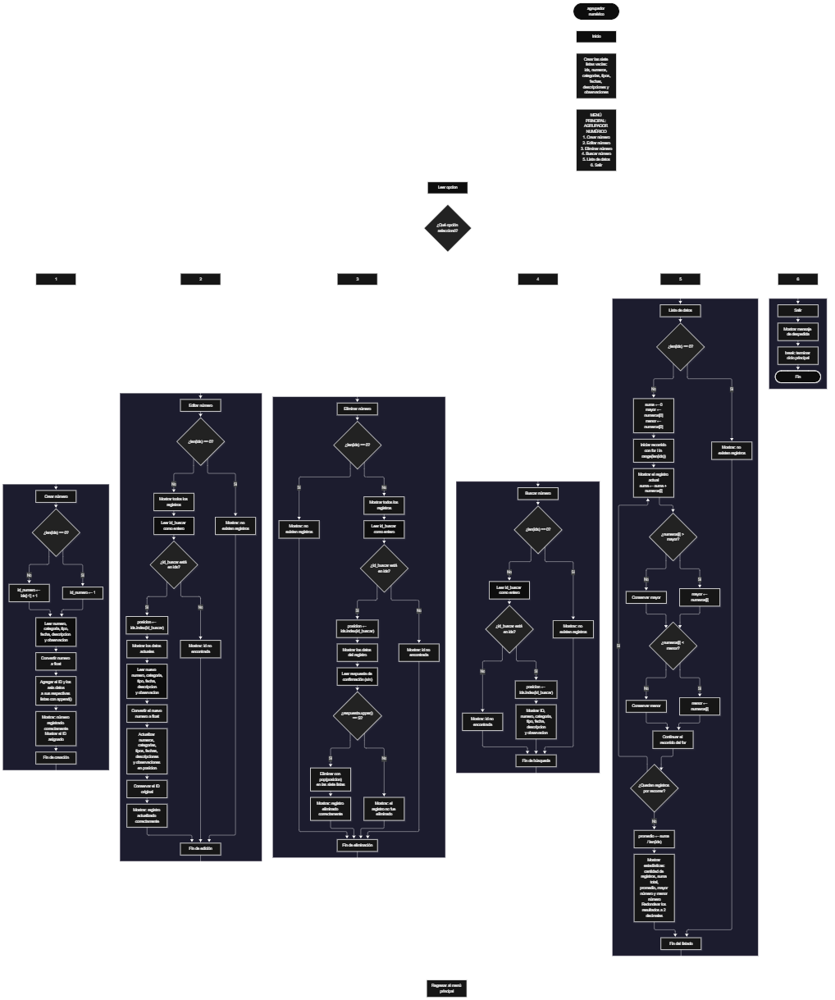

 

Este proyecto, llamado <b>agrupador numérico</b>, fue desarrollado en <b>python</b> como un ejercicio práctico para fortalecer la lógica de programación mediante la creación de un sistema de gestión de números desde la consola. El programa cuenta con un menú principal de seis opciones que permite <b>crear, editar, eliminar, buscar y listar registros numéricos, además de consultar estadísticas</b>. Cada registro almacena información como el número, la categoría, el tipo de número, la fecha, la descripción y la observación. Para organizar los datos, se utilizan siete listas relacionadas que almacenan los identificadores y la información de cada registro durante la ejecución del programa. Durante su desarrollo se aplicaron conceptos fundamentales de programación, como variables, listas, estructuras condicionales, ciclos repetitivos, estructuras de selección y operaciones para buscar, modificar, eliminar y recorrer registros. Este proyecto permite poner en práctica los conocimientos adquiridos en Python y sirve como base para desarrollar sistemas de gestión más avanzados utilizando otros lenguajes y tecnologías.

<h2 align="center">⚙️ Funcionamiento del menú principal</h2>

### ➕ Crear número

La opción <b>1) crear número</b> permite registrar un nuevo número en el agrupador. Antes de almacenar la información, el programa comprueba si la lista <b>ids</b> está vacía mediante la condición <b>len(ids) == 0</b>. Si no existen registros, asigna el identificador inicial <b>1</b> a la variable <b>id_numero</b>. En caso contrario, obtiene el último identificador almacenado mediante <b>ids[-1] + 1</b>. Después, solicita el <b>número, la categoría, el tipo de número, la fecha, la descripción y la observación</b>. El valor numérico se convierte al tipo <b>float</b>, mientras que los demás datos se reciben como texto. A continuación, utiliza el método <b>append()</b> para agregar el identificador y los seis datos a sus respectivas listas. Finalmente, muestra el mensaje <b>"número registrado correctamente."</b> y presenta el identificador asignado al nuevo registro.

### ✏️ Editar número

La opción <b>2) editar número</b> permite modificar la información de un registro existente. Primero, el programa comprueba si la lista <b>ids</b> está vacía. Si no existen registros, muestra el mensaje <b>"no existen registros."</b>. En caso contrario, utiliza un ciclo <b>for</b> para recorrer las listas y mostrar los datos de todos los registros almacenados. Después, solicita el identificador del registro que se desea editar y convierte el valor introducido a un número entero mediante <b>int()</b>. El programa comprueba si el identificador se encuentra en la lista <b>ids</b>. Si existe, utiliza <b>ids.index(id_buscar)</b> para obtener la posición correspondiente y muestra los datos actuales del registro. A continuación, solicita el nuevo número, la nueva categoría, el nuevo tipo de número, la nueva fecha, la nueva descripción y la nueva observación. El número se convierte a <b>float</b> y los demás datos se actualizan directamente en sus respectivas listas. El identificador original se conserva. Finalmente, muestra el mensaje <b>"registro actualizado correctamente."</b>. Si el identificador no existe, presenta el mensaje <b>"id no encontrada."</b>.

### 🗑️ Eliminar número

La opción <b>3) eliminar número</b> permite eliminar un registro almacenado mediante su identificador. Antes de comenzar, el programa comprueba si existen registros en la lista <b>ids</b>. Si la lista está vacía, muestra el mensaje <b>"no existen registros."</b>. Si hay información disponible, presenta todos los registros mediante un ciclo <b>for</b>. Después, solicita el identificador que se desea eliminar y lo convierte a entero. Si el identificador se encuentra en la lista <b>ids</b>, utiliza <b>ids.index(id_buscar)</b> para determinar su posición y muestra los datos del registro seleccionado. A continuación, solicita una confirmación mediante la pregunta <b>"¿desea eliminar este registro? (s/n):"</b>. Si la respuesta convertida a mayúsculas mediante <b>respuesta.upper()</b> es igual a <b>"S"</b>, el programa utiliza el método <b>pop(posicion)</b> para eliminar los datos correspondientes de las siete listas: <b>ids, numeros, categorias, tipos, fechas, descripciones y observaciones</b>. Finalmente, muestra el mensaje <b>"registro eliminado correctamente."</b>. Si el usuario no confirma la eliminación, presenta el mensaje <b>"el registro no fue eliminado."</b>. Si el identificador no existe, muestra <b>"id no encontrada."</b>.

### 🔎 Buscar número

La opción <b>4) buscar número</b> permite localizar un registro mediante su identificador. Primero, el programa comprueba si existen registros almacenados en la lista <b>ids</b>. Si no hay información disponible, muestra el mensaje <b>"no existen registros."</b>. En caso contrario, solicita el identificador que se desea buscar y convierte el valor introducido a entero mediante <b>int()</b>. Después, comprueba si el identificador se encuentra en la lista <b>ids</b>. Si existe, utiliza <b>ids.index(id_buscar)</b> para obtener la posición del registro y muestra toda su información: identificador, número, categoría, tipo de número, fecha, descripción y observación. Si el identificador no está registrado, presenta el mensaje <b>"id no encontrada."</b>. Esta operación permite consultar los datos de un registro específico sin necesidad de recorrer manualmente toda la información mostrada en la lista.

### 📋 Lista de datos

La opción <b>5) lista de datos</b> permite visualizar todos los registros almacenados y calcular estadísticas sobre los números registrados. Antes de comenzar, el programa comprueba si la lista <b>ids</b> está vacía. Si no existen registros, muestra el mensaje <b>"no existen registros."</b>. Si hay información disponible, inicializa las variables <b>suma</b>, <b>mayor</b> y <b>menor</b>. La variable <b>suma</b> comienza en cero, mientras que <b>mayor</b> y <b>menor</b> reciben como valor inicial el primer número almacenado en la lista <b>numeros</b>. Después, utiliza un ciclo <b>for</b> para recorrer los registros, mostrar sus datos, acumular los valores numéricos y comparar cada número con los valores máximo y mínimo encontrados. Al finalizar el recorrido, calcula el promedio mediante la operación <b>suma / len(ids)</b>. Finalmente, presenta las estadísticas del agrupador numérico: cantidad de registros, suma total, promedio, mayor número y menor número. Los resultados numéricos de las estadísticas se muestran redondeados a dos decimales mediante la función <b>round()</b>.

### 🚪 Salir del menú principal

La opción <b>6) salir</b> permite finalizar la ejecución del programa. Cuando el usuario selecciona esta opción, el programa muestra el mensaje <b>"gracias por utilizar el agrupador numérico."</b> y ejecuta la instrucción <b>break</b>, que interrumpe el ciclo <b>while</b> principal y termina la repetición del menú. Si el usuario introduce un valor diferente de las opciones disponibles, el programa ejecuta el bloque <b>else</b> y muestra el mensaje <b>"opción no válida."</b>. De esta manera, el menú principal permanece activo mientras el usuario realiza las operaciones de gestión de registros y finaliza cuando selecciona la opción de salida.

<h2 align="center">🧠 Temas aplicados en el proyecto</h2>

### 📦 Variables

En este proyecto se utilizan variables para controlar la opción seleccionada en el menú, asignar identificadores, almacenar temporalmente los datos introducidos, localizar registros y calcular estadísticas. Cada variable cumple una función específica dentro de las operaciones de gestión del agrupador numérico y permite organizar el procesamiento de la información durante la ejecución del programa.

🔢 **Opcion:** Almacena la opción seleccionada por el usuario en el menú principal.

🆔 **Id_numero:** Almacena el identificador asignado al nuevo registro.

🔎 **Id_buscar:** Almacena el identificador introducido para localizar un registro durante las operaciones de edición, eliminación y búsqueda.

📍 **Posicion:** Representa la posición del registro encontrado dentro de las listas y permite consultar, modificar o eliminar sus datos.

📝 **Numero, categoria, tipo, fecha, descripcion y observacion:** Almacenan temporalmente los datos introducidos durante el registro de un número.

🔢 **Suma:** Acumula los valores numéricos de los registros para calcular la suma total.

📈 **Mayor:** Almacena el mayor valor numérico encontrado durante el recorrido de los registros.

📉 **Menor:** Almacena el menor valor numérico encontrado durante el recorrido de los registros.

📊 **Promedio:** Almacena el resultado de dividir la suma total entre la cantidad de registros.

🔄 **I:** Funciona como contador en los ciclos <b>for</b> utilizados para recorrer y mostrar los registros.

### 🗃️ Listas

En este proyecto se utilizan siete listas relacionadas para almacenar los identificadores y los datos de cada registro. Todas las listas mantienen una correspondencia entre sus posiciones, de modo que los elementos ubicados en el mismo índice pertenecen al mismo registro. Por ejemplo, la información de un registro situado en la posición <b>0</b> se encuentra distribuida entre <b>ids[0], numeros[0], categorias[0], tipos[0], fechas[0], descripciones[0] y observaciones[0]</b>. Esta organización permite agregar, consultar, modificar, eliminar y recorrer los registros utilizando sus posiciones correspondientes.

🆔 **Ids:** Almacena los identificadores de los registros numéricos.

🔢 **Numeros:** Almacena los valores numéricos registrados como números de tipo <b>float</b>.

🏷️ **Categorias:** Almacena las categorías asignadas a los números.

📌 **Tipos:** Almacena el tipo de número registrado.

📅 **Fechas:** Almacena las fechas asociadas a los registros.

📝 **Descripciones:** Almacena las descripciones de los registros.

💬 **Observaciones:** Almacena las observaciones adicionales de cada registro.

### 🔀 Estructuras condicionales

En este proyecto se utilizan las estructuras condicionales <b>if, elif y else</b> para controlar las opciones del menú y determinar qué operación debe ejecutarse. También se emplean para comprobar si existen registros antes de realizar determinadas operaciones, verificar si un identificador se encuentra en la lista <b>ids</b>, decidir si se debe eliminar un registro según la confirmación del usuario y comparar los valores numéricos para determinar el mayor y el menor. Estas condiciones permiten que el programa responda de manera diferente según los datos almacenados y los resultados de cada comprobación.

### 🔄 Estructuras repetitivas

En este proyecto se utilizan las estructuras repetitivas <b>while</b> y <b>for</b>. El ciclo <b>while True</b> mantiene activo el menú principal y permite que el usuario seleccione diferentes operaciones hasta ejecutar la instrucción <b>break</b>. Por otro lado, los ciclos <b>for</b> recorren las listas para mostrar los registros almacenados y calcular las estadísticas numéricas. Estos recorridos permiten procesar la información de manera organizada sin necesidad de escribir instrucciones independientes para cada registro.

### 🎯 Estructura de selección

El programa utiliza una estructura de selección mediante la cadena de condiciones <b>if, elif y else</b> para evaluar el valor almacenado en la variable <b>opcion</b>. Cada condición representa una operación específica del sistema: <b>crear, editar, eliminar, buscar, listar o salir</b>. Además, el bloque <b>else</b> permite mostrar el mensaje <b>"opción no válida."</b> cuando el usuario introduce un valor que no coincide con ninguna de las opciones definidas en el menú. Esta estructura organiza el funcionamiento principal del programa y facilita la ejecución de las operaciones disponibles.

### 🔍 Búsqueda por identificador

El programa utiliza el operador <b>in</b> para comprobar si un identificador está presente en la lista <b>ids</b>. Cuando encuentra el identificador solicitado, utiliza el método <b>index()</b> para obtener la posición del registro correspondiente. Esta posición se utiliza posteriormente para mostrar los datos, actualizar la información o eliminar el registro seleccionado. La combinación de estas operaciones permite localizar registros sin tener que comparar manualmente cada identificador dentro de las listas.

### 🧮 Cálculo de estadísticas

El programa utiliza operaciones aritméticas y estructuras condicionales para calcular estadísticas de los números registrados. La variable <b>suma</b> acumula los valores mediante la operación <b>suma += numeros[i]</b>. Las variables <b>mayor</b> y <b>menor</b> se actualizan cuando el número actual es superior al mayor valor encontrado o inferior al menor valor encontrado. Después del recorrido, el promedio se calcula dividiendo la suma entre la cantidad de registros. Finalmente, la función <b>round()</b> permite presentar los resultados numéricos con dos decimales. Estas operaciones proporcionan un resumen de los valores almacenados en el agrupador numérico.

### 🔄 Gestión de listas paralelas

Las siete listas se administran de forma coordinada para conservar la relación entre los identificadores y los datos de cada registro. Al crear un número, el programa agrega un elemento a cada lista mediante <b>append()</b>. Al editar un registro, actualiza los elementos de las listas correspondientes utilizando una misma posición. Durante la eliminación, utiliza <b>pop(posicion)</b> en las siete listas para retirar los elementos relacionados. Esta organización permite mantener los datos de cada registro alineados durante las operaciones de gestión.

<h2 align="center">¿Cómo se implementaron las operaciones crud en el proyecto?</h2>

Las operaciones <b>crud</b> se implementaron mediante las opciones del menú principal, permitiendo administrar los registros del agrupador numérico. La operación <b>crear</b> corresponde a <b>crear número</b>, donde se introduce la información de un nuevo registro; <b>leer</b> se realiza mediante las opciones <b>buscar número y lista de datos</b>, que permiten consultar registros específicos o visualizar todos los datos junto con sus estadísticas; <b>actualizar</b> corresponde a <b>editar número</b>, donde se modifican los datos de un registro existente; y <b>eliminar</b> se realiza mediante la opción <b>eliminar número</b>, que solicita confirmación antes de retirar la información de las listas. Estas operaciones utilizan listas, variables, condicionales y ciclos para gestionar la información almacenada temporalmente durante la ejecución del programa.

<h2 align="center">Diagrama de flujo del proyecto</h2>

<h2 align="center">🛡️ Validaciones del programa</h2>

### 📭 No existen registros

Esta comprobación se utiliza en las opciones de <b>editar, eliminar, buscar y lista de datos</b>. El programa comprueba si la lista <b>ids</b> está vacía mediante la condición <b>len(ids) == 0</b>. Si no existen registros, muestra el mensaje <b>"no existen registros."</b> y no continúa con la operación solicitada. Esta comprobación evita acceder a posiciones de las listas cuando todavía no se ha almacenado información.

### 🔎 Identificador no encontrado

Esta comprobación se utiliza en las operaciones de <b>editar, eliminar y buscar número</b>. Después de solicitar el identificador, el programa comprueba si su valor se encuentra en la lista <b>ids</b> mediante el operador <b>in</b>. Si el identificador existe, obtiene su posición mediante <b>ids.index(id_buscar)</b> y continúa con la operación correspondiente. Si no existe, muestra el mensaje <b>"id no encontrada."</b>. Esta comprobación permite evitar la consulta, modificación o eliminación de un registro cuyo identificador no está almacenado.

### ⚠️ Confirmación de eliminación

Esta comprobación se utiliza en la opción <b>eliminar número</b>. Después de mostrar los datos del registro seleccionado, el programa solicita una respuesta mediante la variable <b>respuesta</b>. La condición <b>respuesta.upper() == "S"</b> permite aceptar la confirmación cuando el usuario introduce la letra <b>s</b> o <b>S</b>. Si la condición se cumple, el programa elimina los datos de las siete listas mediante <b>pop(posicion)</b>. En caso contrario, muestra el mensaje <b>"el registro no fue eliminado."</b> y conserva los datos del registro.

### ⚠️ Opción no válida

La estructura condicional del menú incluye un bloque <b>else</b> que muestra el mensaje <b>"opción no válida."</b> cuando el valor introducido no coincide con ninguna de las opciones definidas. Las opciones disponibles son los valores de texto <b>"1", "2", "3", "4", "5" y "6"</b>. Esta comprobación permite informar al usuario cuando selecciona una opción diferente de las disponibles. Sin embargo, el programa no valida que la entrada corresponda necesariamente a un número antes de compararla con las opciones.

### 🔢 Conversión de datos numéricos

El programa utiliza la función <b>float()</b> para convertir el número introducido durante el registro o la edición, y la función <b>int()</b> para convertir el identificador solicitado durante las operaciones de edición, eliminación y búsqueda. Estas conversiones permiten trabajar con los datos en los tipos numéricos correspondientes. Sin embargo, el código actual no incluye un manejo de excepciones para las entradas que no puedan convertirse correctamente, por lo que introducir un valor no válido puede interrumpir la ejecución del programa.

### 🗂️ Organización de los registros

El programa utiliza la misma posición para relacionar los datos almacenados en las siete listas. Durante la creación, agrega los elementos mediante <b>append()</b>; durante la edición, actualiza los valores de la posición encontrada; y durante la eliminación, retira los elementos correspondientes mediante <b>pop(posicion)</b>. De esta manera, los datos relacionados con un registro se eliminan conjuntamente y las listas mantienen la correspondencia entre sus elementos. No obstante, el identificador del siguiente registro se calcula a partir del último elemento de la lista <b>ids</b>, por lo que, si se elimina el último registro, un identificador previamente utilizado puede volver a asignarse.

<h2 align="center">🎯 Objetivo del proyecto</h2>

El objetivo principal de este proyecto es fortalecer la <b>lógica de programación</b> mediante el desarrollo de un sistema de gestión de registros numéricos en <b>python</b>. A través de su construcción se busca aplicar los conocimientos adquiridos sobre variables, listas, estructuras condicionales, ciclos repetitivos, búsqueda de registros y operaciones aritméticas, integrándolos para resolver un problema de manera organizada. Además, el proyecto permite comprender cómo registrar, consultar, modificar y eliminar información, así como calcular estadísticas básicas a partir de los datos almacenados temporalmente en una aplicación de consola. Estos conocimientos constituyen una base para desarrollar sistemas de gestión más completos con otros lenguajes y tecnologías.

